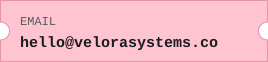
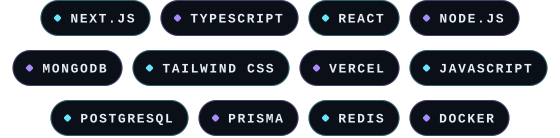

  

&nbsp;
&nbsp;

 

### `01` &nbsp;About

I'm a self-taught full stack developer who builds software that creates **measurable business impact** — not just clean code, but systems that change how teams operate.

<table>
<tr><td><code>FOUNDER</code></td><td><a href="https://velorasystems.co"><b>Velora Systems</b></a> — hospitality tech for modern restaurants &amp; businesses</td></tr>
<tr><td><code>BUILDING</code></td><td><b>Dines</b> — a full QR ordering &amp; restaurant operating system</td></tr>
<tr><td><code>ALSO SHIPPING</code></td><td><a href="https://github.com/rajithdev/uptimekit"><b>UptimeKit</b></a> — open-source uptime monitoring, plus the builds below</td></tr>
<tr><td><code>FOCUS</code></td><td><b>Next.js</b>, <b>Node.js</b>, <b>TypeScript</b>, <b>PostgreSQL</b> and <b>MongoDB</b></td></tr>
<tr><td><code>BASE</code></td><td><b>Kaunas, Lithuania</b></td></tr>
</table>

### `02` &nbsp;Featured build — [Dines](https://dines-check.vercel.app)

A full-stack restaurant operating system built for modern venues.

**Stack** &nbsp;<code>Next.js</code> <code>Node.js</code> <code>MongoDB</code> <code>WebSockets</code> <code>TypeScript</code> &nbsp;·&nbsp; [**Live demo ↗**](https://dines-check.vercel.app) &nbsp;·&nbsp; [**Source ↗**](https://github.com/rajithdev/aukstaitija-restaurant)

### `03` &nbsp;More builds

**Live** &nbsp;[UptimeKit ↗](https://web-production-8c11c7f5.up.railway.app/demo) &nbsp;·&nbsp; [Game-key Marketplace ↗](https://eneba-marketplace-ten.vercel.app) &nbsp;·&nbsp; [Student Tools ↗](https://rajithdev.github.io/student-tools/) &nbsp;·&nbsp; [Komorebi 木漏れ日商店 ↗](https://komorebi-three-eta.vercel.app)

### `04` &nbsp;Toolkit

### `05` &nbsp;Activity

 

Built with <a href="https://github.com/rajithdev/profile-forge">profile-forge</a>

