

I'm an Informatics student at Vytautas Magnus University and a full-stack developer who learns by shipping. I build software that real businesses run on: not just clean code, but systems that change how teams operate.

- **Founder:** [**Velora Systems**](https://velorasystems.co) — hospitality tech for modern restaurants & businesses
- **Studying:** Informatics (BSc) at **Vytautas Magnus University**, 2024–2028
- **Building:** **Dines** — a restaurant operating system that three paying restaurants run their daily service on
- **Focus:** **React**, **TypeScript**, **Next.js**, **Laravel (PHP)**, **PostgreSQL** and **MongoDB**
- **Base:** **Kaunas, Lithuania**

## Dines

<a href="https://getdines.com"></a>
<a href="https://getdines.com"></a>

A restaurant operating system in production: Bunsik Bites, Fried Fusion and Cake Lake run their daily service on it. Its website, getdines.com, is where restaurants learn about it and sign in; the production code is private.

**Built with** Next.js, React, JavaScript, MongoDB, Razorpay, Electron. **[getdines.com](https://getdines.com)**

## Builds

White tickets are web apps, yellow are extensions and mobile apps, pink are games and creative work.

<a href="https://github.com/rajithdev/eneba-marketplace">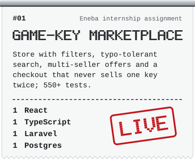</a>
<a href="https://github.com/rajithdev/uptimekit">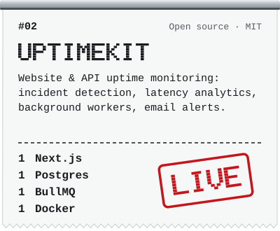</a>
<a href="https://github.com/rajithdev/student-tools">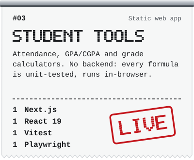</a>
<a href="https://komorebi-three-eta.vercel.app">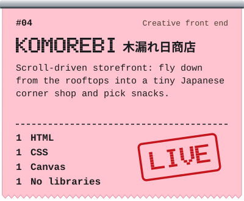</a>
<a href="https://github.com/rajithdev/route-explorer">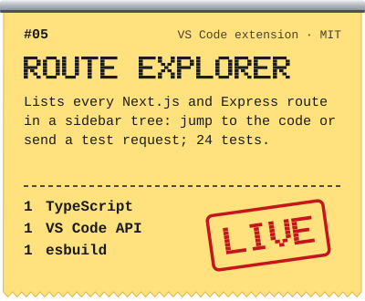</a>
<a href="https://github.com/rajithdev/autoskip-android">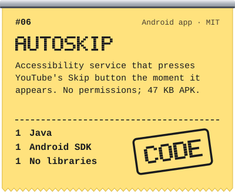</a>
<a href="https://gravetide.vercel.app">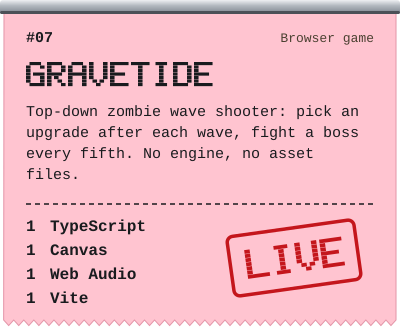</a>
<a href="https://github.com/rajithdev/unbait">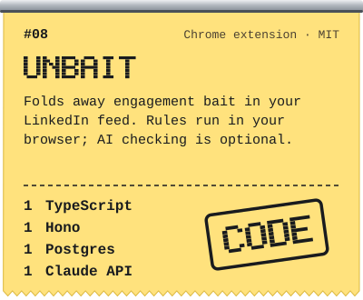</a>

**Try them:** [Game-key Marketplace](https://eneba-marketplace-ten.vercel.app) · [UptimeKit](https://web-production-8c11c7f5.up.railway.app/demo) · [Student Tools](https://rajithdev.github.io/student-tools/) · [Komorebi 木漏れ日商店](https://komorebi-three-eta.vercel.app) · [Route Explorer](https://marketplace.visualstudio.com/items?itemName=rajithdev.route-explorer) · [Gravetide](https://gravetide.vercel.app)

## Toolkit

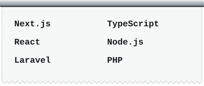
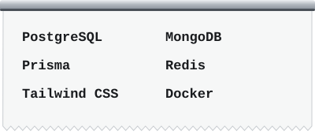

Velora Systems · Kaunas, LT

