  

&nbsp;
&nbsp;

 

### `01` &nbsp;About

I'm an Informatics student at Vytautas Magnus University and a full-stack developer who learns by shipping. I build software that real businesses run on: not just clean code, but systems that change how teams operate.

<table>
<tr><td><code>FOUNDER</code></td><td><a href="https://velorasystems.co"><b>Velora Systems</b></a> — hospitality tech for modern restaurants &amp; businesses</td></tr>
<tr><td><code>STUDYING</code></td><td>Informatics (BSc) at <b>Vytautas Magnus University</b>, 2024–2028</td></tr>
<tr><td><code>BUILDING</code></td><td><b>Dines</b> — a restaurant operating system that three paying restaurants run their daily service on</td></tr>
<tr><td><code>ALSO SHIPPING</code></td><td><a href="https://github.com/rajithdev/uptimekit"><b>UptimeKit</b></a> — open-source uptime monitoring, plus the builds below</td></tr>
<tr><td><code>FOCUS</code></td><td><b>React</b>, <b>TypeScript</b>, <b>Next.js</b>, <b>Laravel (PHP)</b>, <b>PostgreSQL</b> and <b>MongoDB</b></td></tr>
<tr><td><code>BASE</code></td><td><b>Kaunas, Lithuania</b></td></tr>
</table>

### `02` &nbsp;Featured build — [Dines](https://getdines.com)

A restaurant operating system in production: Bunsik Bites, Fried Fusion and Cake Lake run their daily service on it. Its website, getdines.com, is where restaurants learn about it and sign in; the production code is private.

**Stack** &nbsp;<code>Next.js</code> <code>React</code> <code>JavaScript</code> <code>MongoDB</code> <code>Razorpay</code> <code>Electron</code>

### `03` &nbsp;More builds

**Live** &nbsp;[Game-key Marketplace ↗](https://eneba-marketplace-ten.vercel.app) &nbsp;·&nbsp; [UptimeKit ↗](https://web-production-8c11c7f5.up.railway.app/demo) &nbsp;·&nbsp; [Student Tools ↗](https://rajithdev.github.io/student-tools/) &nbsp;·&nbsp; [Komorebi 木漏れ日商店 ↗](https://komorebi-three-eta.vercel.app) &nbsp;·&nbsp; [Route Explorer ↗](https://marketplace.visualstudio.com/items?itemName=rajithdev.route-explorer) &nbsp;·&nbsp; [Gravetide ↗](https://gravetide.vercel.app)

### `04` &nbsp;Toolkit

### `05` &nbsp;Activity

 

Built with <a href="https://github.com/rajithdev/profile-forge">profile-forge</a>

